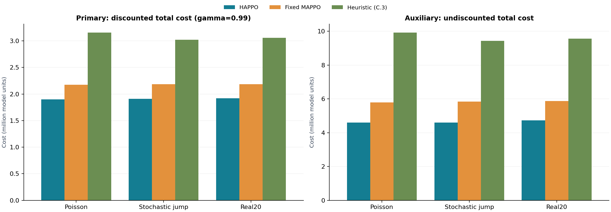

# SteelNet：平台采购与订单分配 Demo

一个可直接运行的三主体供应链演示，比较**最终 HAPPO、固定 MAPPO 和滚动 base-stock 启发式**。平台决定采购总量及 SME 订单份额，LE、SME 分别决定补货量。

仓库包含预训练模型和**全部 20 条 × 366 点需求数据，共 7,320 个观测值**。运行时加载模型进行评估，无需重新训练。

[English](README_en.md) · [数据说明](docs/DATA_CARD.md) · [模型说明](docs/MODEL_CARD.md) · [参数与指标](docs/CONFIGURATION.md)

## 安装

已在 Python 3.12 上测试。在终端中运行：

```bash
git clone https://github.com/MaZuqin/steelnet-self-preferencing-demo.git
cd steelnet-self-preferencing-demo
python -m venv .venv
```

Windows PowerShell 激活环境：

```powershell
.venv\Scripts\Activate.ps1
```

macOS / Linux 激活环境：

```bash
source .venv/bin/activate
```

安装依赖并检查公开数据：

```bash
python -m pip install -r requirements.txt
python demo.py validate-data
```

如需 NVIDIA GPU，请按 [PyTorch 官方安装页面](https://pytorch.org/get-started/locally/)选择与本机匹配的 CUDA 版本。安装后可运行 `python -c "import torch; print(torch.cuda.is_available())"` 检查。只有 CPU 也可以运行全部演示。

## 运行

```bash
# 完整演示：三个方法、三个场景，每个场景 20 条路径，每条 366 期
python demo.py

# 快速检查：每个场景 1 条路径、30 期
python demo.py --quick

# 指定 GPU 或 CPU
python demo.py --device cuda
python demo.py --quick --device cpu

# 只评估全部公开需求路径
python demo.py --scenarios real20 --output outputs/real20
```

默认自动使用可用的 CUDA GPU，否则使用 CPU。完整评估使用固定模型和固定需求库；快速模式用于检查环境与流程。

完成后打开 **`outputs/demo/report.html`**，即可查看离线报告。输出还包括逐期记录 `steps.csv`、逐路径结果 `episodes.csv`、汇总 `summary.csv` 和运行参数 `run.json`。`--output` 可以指定其他目录；`--paths 1` 至 `--paths 20` 可以控制路径数。

## 对比结果

以下为随仓库提供的完整示例：每个场景 20 条 × 366 期，训练种子 2026，固定模型，GPU 推理。主指标为折扣库存持有与积压成本，折扣因子 0.99；数值越小越好。

| 场景 | HAPPO | 固定 MAPPO | 启发式 |
| --- | ---: | ---: | ---: |
| Poisson 平稳需求 | 1,900,318.86 | 2,175,859.61 | 3,156,894.30 |
| 随机跳跃需求 | 1,908,967.14 | 2,184,689.53 | 3,018,321.65 |
| Real20 | 1,921,471.90 | 2,183,914.49 | 3,059,363.41 |



完整示例位于 [examples/final](examples/final)。下载仓库后可直接打开其中的 `report.html`。结果描述的是所附模型在这组需求路径上的表现；不同设备或依赖版本可能产生少量数值差别。

## 文件结构

| 路径 | 内容 |
| --- | --- |
| `demo.py` | 统一入口 |
| `configs/demo.yaml` | 环境、动作上限、启发式和评估参数 |
| `algorithm/`、`envs/`、`steelnet/` | 网络、环境、评估及报告代码 |
| `checkpoints/happo.pt` | 最终 HAPPO 模型 |
| `checkpoints/mappo.pt` | 固定 MAPPO 模型 |
| `checkpoints/manifest.json` | 模型校验值与来源信息 |
| `demand/data/real_20.xlsx` | 原始提供的完整工作簿 |
| `demand/data/real_demand_wide.csv` | 366 行、20 条需求路径 |
| `demand/data/real_demand_long.csv` | 7,320 条路径—时间观测记录 |
| `examples/final/` | 示例结果、图片及离线报告 |
| `tests/` | 数据、模型和指标检查 |

数据在仿真中先转换为 float32，再除以 1,000；公开文件保留原数值。`day_index` 为观测序号。代码和数据的使用条款见 [RIGHTS.md](RIGHTS.md)。

## 检查

```bash
python demo.py validate-data
python -m unittest discover -s tests -v
python demo.py --quick --device cpu
```

GitHub Actions 会自动运行以上检查。`requirements-tested.txt` 记录本次验证使用的直接依赖版本。
