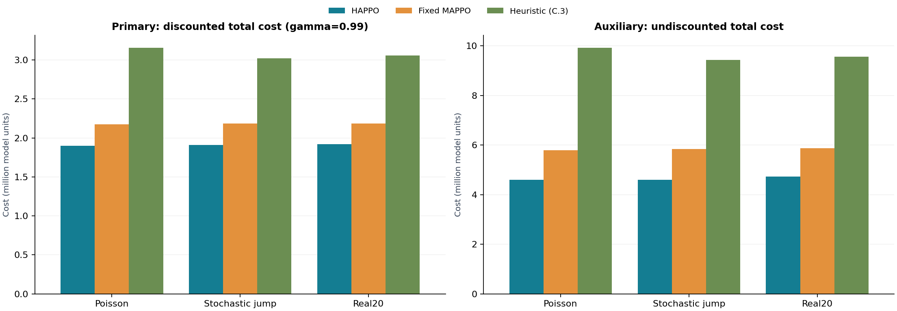

# SteelNet procurement and allocation demo

A runnable three-agent supply-chain demo comparing **final HAPPO, fixed MAPPO and a causal rolling base-stock heuristic**. The platform chooses total procurement and SME allocation; each supplier chooses replenishment. The repository includes pretrained models and **all 20 × 366 demand observations (7,320 values)**.

[中文](README.md) · [Data card](docs/DATA_CARD.md) · [Model card](docs/MODEL_CARD.md) · [Configuration](docs/CONFIGURATION.md)

## Install

Python 3.12 was used for release validation.

```bash
git clone https://github.com/MaZuqin/steelnet-self-preferencing-demo.git
cd steelnet-self-preferencing-demo
python -m venv .venv
```

Activate with `.venv\Scripts\Activate.ps1` in Windows PowerShell, or `source .venv/bin/activate` on macOS/Linux. Then:

```bash
python -m pip install -r requirements.txt
python demo.py validate-data
python demo.py
```

For NVIDIA GPU support, select the appropriate CUDA build on the [official PyTorch installation page](https://pytorch.org/get-started/locally/). Check availability with `python -c "import torch; print(torch.cuda.is_available())"`. CPU execution is also supported.

## Run

The default command evaluates all three methods on Poisson, stochastic-jump and Real20 demand, with 20 paths of 366 periods per scenario. It automatically selects CUDA when available. It performs inference, without training.

```bash
python demo.py --quick                    # 1 path × 30 periods per scenario
python demo.py --device cuda              # require CUDA
python demo.py --quick --device cpu       # CPU smoke check
python demo.py --scenarios real20 --output outputs/real20
```

Open `outputs/demo/report.html` for the offline report. The output directory also contains `steps.csv`, `episodes.csv`, `summary.csv` and `run.json`. Use `--paths` for 1–20 paths, `--methods happo,mappo` for selected methods, or `--output` for another directory.

## Included results

The [final example](examples/final) contains the full evaluation of the included models (training seed 2026). Primary discounted holding-plus-backlog costs, averaged across 20 paths:

| Scenario | HAPPO | Fixed MAPPO | Heuristic |
| --- | ---: | ---: | ---: |
| Poisson | 1,900,318.86 | 2,175,859.61 | 3,156,894.30 |
| Stochastic jump | 1,908,967.14 | 2,184,689.53 | 3,018,321.65 |
| Real20 | 1,921,471.90 | 2,183,914.49 | 3,059,363.41 |



The discount factor is 0.99. Undiscounted cost, node components and branch bullwhip are also reported. These results describe the included checkpoints on the specified demand banks; numerical details may vary slightly across devices or dependencies.

## Data and checks

`demand/data/` includes the unchanged XLSX, wide and long CSV exports, and SHA-256 checksums. Runtime demand is cast to float32 before division by 1,000. Published values retain their original scale. `day_index` is an observation index.

```bash
python demo.py validate-data
python -m unittest discover -s tests -v
```

GitHub Actions also runs a CPU smoke evaluation. See [RIGHTS.md](RIGHTS.md) for code/data reuse status and `requirements-tested.txt` for tested direct dependencies.
